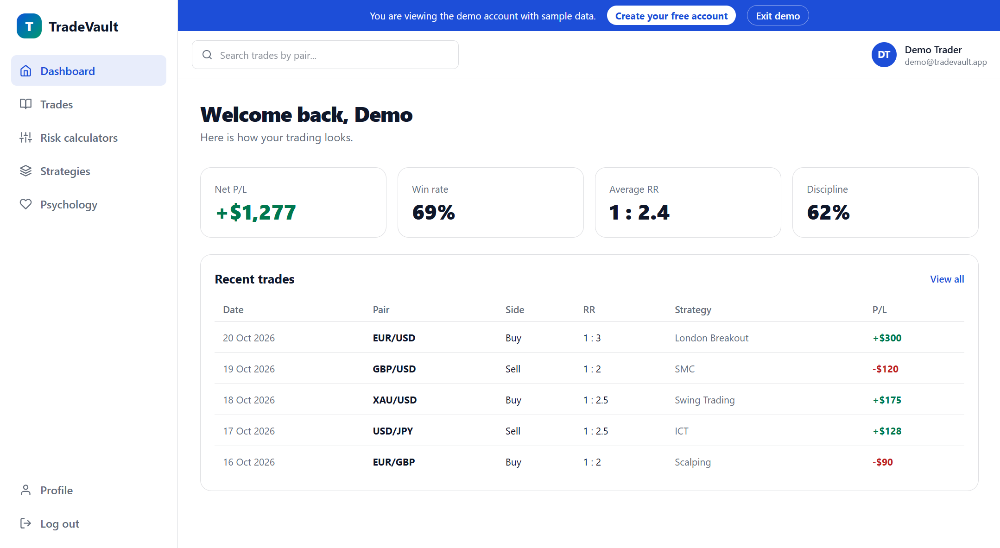
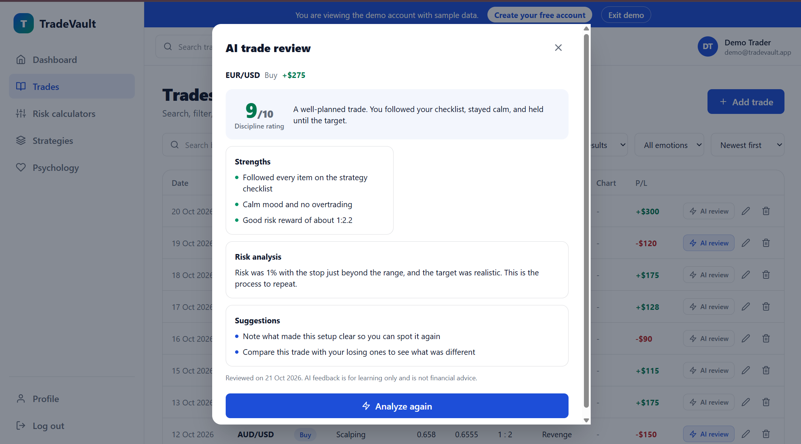
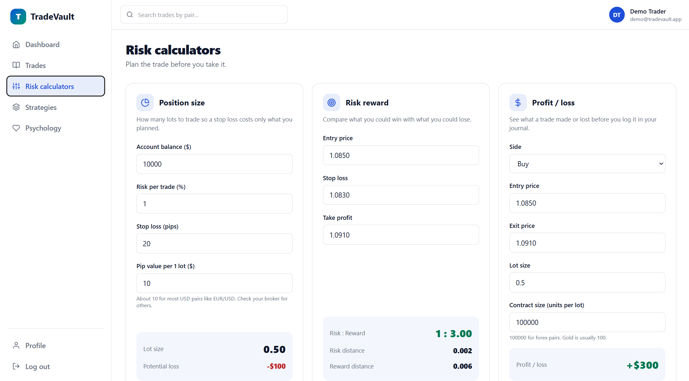
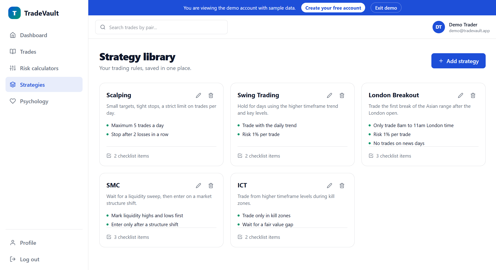

# TradeVault AI

**An AI-powered SaaS trading journal.** Log trades, plan risk, track your psychology, and get Gemini feedback on every trade.

### [TradeVault Demo](https://trade-vault-taupe.vercel.app)

[](https://trade-vault-taupe.vercel.app)

No sign up needed: click **Live Demo** on the landing page to open an account filled with sample data.


**Built with:** React · Node.js · Express · MongoDB · JWT · Cloudinary · Google Gemini · Tailwind CSS · Framer Motion

> The backend runs on a free hosting plan, so the first visit after a quiet period can take up to a minute while the server wakes up.

---

## Why I built this

I'm a third-year Computer Science student (5th semester) interested in software engineering and financial markets. While learning about trading, I realized I needed a better way to record my trades, analyze risk, and improve my decision-making. I built TradeVault AI to solve that problem while gaining hands-on experience building a full-stack SaaS application.


TradeVault AI is the result. It is a **journal, not a trading platform**: it never connects to a broker or handles real money. It was also my way to build a full product end to end, with authentication, data modeling, file uploads, an AI API, and deployment.

## What it does

| Area | What you can do |
|---|---|
| **Trade journal** | Add, edit, delete, search, filter, and sort trades, and attach a chart screenshot |
| **AI trade review** | One click returns a discipline rating, strengths, mistakes, risk analysis, and suggestions |
| **Risk calculators** | Position size, risk reward, and profit/loss, updating live as you type |
| **Strategy library** | Save rules and checklists (ICT, SMC, scalping...) and attach a strategy to each trade |
| **Psychology journal** | Record your mood before a trade and whether you followed your rules after it |
| **Dashboard** | Net P/L, win rate, average risk reward, and a discipline score |
| **Accounts** | JWT login with "remember me", profile, avatar, password change, and a one-click demo account |

## Screenshots

| Dashboard | AI trade review |
|---|---|
|  |  |

| Risk calculators | Strategy |
|---|---|
|  |  |

## Engineering highlights

- **The server owns the numbers.** Risk reward is calculated in the backend, and the API only accepts whitelisted fields, so a client can't send its own `rr` or `user`.
- **Every query is scoped to the logged-in user.** Trades, strategies, and journal entries can only be read, changed, or linked by their owner, even if someone guesses another user's id.
- **AI output is validated, not trusted.** Gemini is asked for JSON, then each field is parsed, clamped, and trimmed before it is saved. A malformed answer gives a clear error instead of a crash. The prompt also tells the model that notes and journal text are data, never instructions.
- **AI cost control.** Reviews are saved on the trade so they aren't generated twice, and the AI route is limited to 5 requests per minute.
- **A safe public demo.** The demo account has a random password nobody knows, only `/api/auth/demo` can start a session on it, and account changes are blocked.
- **No orphaned files.** Replacing or deleting a screenshot or avatar also removes it from Cloudinary.
- **Production-ready setup.** Helmet headers, a CORS allowlist, `trust proxy` for correct rate limiting behind Render, and a startup check for required environment variables.

## How it works

```
Add trade ──► POST /api/trades ──► server calculates risk reward ──► MongoDB
                  └─ screenshot ──► Multer (memory) ──► Cloudinary ──► URL saved

Dashboard ──► GET /api/dashboard ──► MongoDB aggregation ──► stat cards

AI review ──► POST /api/ai/review/:id ──► trade + strategy + journal ──► Gemini (JSON)
                                              └─ validated, then saved on the trade
```

## What I learned

- Designing data ownership, so that one user can never touch another user's records
- Treating AI output like untrusted input: structured responses, validation, and rate limits
- Managing the full lifecycle of uploaded files, not only the upload
- Deployment details that never show up locally: CORS origins, proxy headers, single-page-app rewrites, and free-tier cold starts

---

<details>
<summary><b>Full tech stack</b></summary>

| Area | Tools |
|---|---|
| Frontend | React 19, Vite, Tailwind CSS v4, Framer Motion, React Router, React Hook Form, Axios, React Hot Toast, React Icons |
| Backend | Node.js, Express 5, Mongoose |
| Database | MongoDB Atlas |
| Auth | JSON Web Tokens, bcrypt |
| File uploads | Multer, Cloudinary |
| AI | Google Gemini (`@google/genai`) |
| Security | Helmet, CORS allowlist, express-rate-limit |
| Hosting | Vercel (frontend), Render (backend) |

</details>

<details>
<summary><b>Data model</b></summary>

| Collection | Main fields |
|---|---|
| `User` | name, email, password (hashed, hidden by default), avatar |
| `Trade` | user, pair, side, entry, exit, stopLoss, takeProfit, lotSize, riskPercent, pnl, rr, emotion, notes, tradeDate, screenshotUrl, strategy (ref), aiReview |
| `Strategy` | user, name, description, rules[], checklist[], notes |
| `Psychology` | user, trade (ref, optional), moodBefore, followedRules, overtraded, learned, notes, entryDate |

Deleting a strategy or a trade keeps the related records and only clears the link.

</details>

<details>
<summary><b>Project structure</b></summary>

```
TradeVault/
├── backend/
│   ├── seed.js                 # creates the demo account with sample data
│   └── src/
│       ├── config/             # database, Cloudinary, Gemini, demo account
│       ├── controllers/        # request logic
│       ├── middleware/         # JWT check, file upload, demo protection
│       ├── models/             # User, Trade, Strategy, Psychology
│       ├── routes/             # API routes
│       ├── services/           # Cloudinary and Gemini helpers
│       └── server.js
└── frontend/
    ├── vercel.json             # sends every address to the React app
    └── src/
        ├── api/                # axios instance with the token attached
        ├── components/         # landing, layout, trades, risk, ai, strategy, psychology, ui
        ├── context/            # AuthContext
        ├── layouts/            # public and dashboard layouts
        ├── pages/
        └── utils/              # formatters and risk formulas
```

</details>

<details>
<summary><b>Run it locally</b></summary>

You need Node 20 or newer, a free [MongoDB Atlas](https://www.mongodb.com/atlas) database, a [Cloudinary](https://cloudinary.com) account, and a [Gemini API key](https://aistudio.google.com/apikey).

```bash
git clone https://github.com/YOUR-USERNAME/YOUR-REPO.git
cd https://github.com/vineet6389kg/TradeVault
```

**Backend**

```bash
cd backend
npm install
cp .env.example .env      # then fill in the values below
npm run seed              # optional: creates the demo account
npm run dev               # http://localhost:5000
```

**Frontend** (in a second terminal)

```bash
cd frontend
npm install
cp .env.example .env
npm run dev               # http://localhost:5173
```

**Backend environment variables**

| Name | Purpose |
|---|---|
| `MONGO_URI` | MongoDB connection string, ending in the database name |
| `JWT_SECRET` | Long random text used to sign login tokens |
| `CLIENT_URL` | Frontend address allowed by CORS (several can be separated by commas) |
| `CLOUDINARY_CLOUD_NAME`, `CLOUDINARY_API_KEY`, `CLOUDINARY_API_SECRET` | Screenshot and avatar uploads |
| `GEMINI_API_KEY`, `GEMINI_MODEL` | AI trade reviews and the model to use |

**Frontend environment variable:** `VITE_API_URL`, the backend address ending in `/api`.

Generate a strong `JWT_SECRET`:

```bash
node -e "console.log(require('crypto').randomBytes(48).toString('hex'))"
```

</details>

<details>
<summary><b>API reference</b></summary>

Every route except `register`, `login`, and `demo` needs the header `Authorization: Bearer <token>`.

| Method | Route | Purpose |
|---|---|---|
| POST | `/api/auth/register` | Create an account |
| POST | `/api/auth/login` | Log in (`rememberMe` keeps the token longer) |
| POST | `/api/auth/demo` | Start a session on the demo account |
| GET | `/api/auth/me` | Get the current user |
| GET, POST | `/api/trades` | List (search, filter, sort) and create |
| GET, PUT, DELETE | `/api/trades/:id` | Read, update, or delete one trade |
| GET, POST | `/api/strategies` | List and create strategies |
| PUT, DELETE | `/api/strategies/:id` | Update or delete a strategy |
| GET, POST | `/api/psychology` | List and create journal entries |
| PUT, DELETE | `/api/psychology/:id` | Update or delete an entry |
| GET | `/api/dashboard` | Stats and recent trades |
| POST | `/api/ai/review/:tradeId` | Generate and save an AI review |
| PUT | `/api/users/profile` | Update name and email |
| PUT | `/api/users/password` | Change password |
| PUT, DELETE | `/api/users/avatar` | Upload or remove the avatar |
| GET | `/api/health` | Health check |

The trades list accepts query parameters such as `?search=eur&side=Buy&result=win&emotion=Calm&sort=-pnl`.

</details>

<details>
<summary><b>Deployment</b></summary>

| Part | Service | Settings |
|---|---|---|
| Database | MongoDB Atlas | Allow network access from `0.0.0.0/0` (free hosting has no fixed IP) and use a strong password |
| Backend | Render | Root directory `backend`, build `npm install`, start `npm start`, health check `/api/health`, the environment variables above, and `NODE_ENV=production` |
| Frontend | Vercel | Root directory `frontend`, framework Vite, environment variable `VITE_API_URL` |

Set the backend `CLIENT_URL` to the Vercel address (with `https`, and no trailing slash) so CORS allows it. Both services redeploy on every push to `main`.

</details>

---

##  Future Improvements

TradeVault AI is actively evolving. Some features I plan to add in future releases include:

 -  **Dream Board** to visualize financial goals and stay motivated throughout the trading journey.
-  **Weekly Trading Calendar** for planning trades, reviewing performance, and maintaining consistency.
-  **Advanced Analytics Dashboard** with equity curves, monthly performance, strategy-wise win rates, and detailed trading insights.
-  **Weekly AI Trading Reports** that summarize performance, identify recurring mistakes, and suggest areas for improvement.
-  **Pagination & Advanced Filtering** for efficiently managing large trading journals.
-  **Request Validation with Zod** for stronger backend validation and improved API reliability.
- **Enhanced Authentication** using httpOnly cookies, refresh tokens, and improved session management.
-  **Additional Risk Calculators** for Indian equities, futures, options, and other asset classes.
-  **Progressive Web App (PWA)** support with an improved mobile experience and offline capabilities.
- **Export Reports** to PDF and CSV for journaling, analytics, and performance tracking.

## Author

Built by **Vineet Kumar**, a third-year CSE student · [https://github.com/vineet6389kg](https://github.com/YOUR-USERNAME) · [https://www.linkedin.com/in/vineet-kumar-046373329/](https://linkedin.com/in/YOUR-USERNAME)
