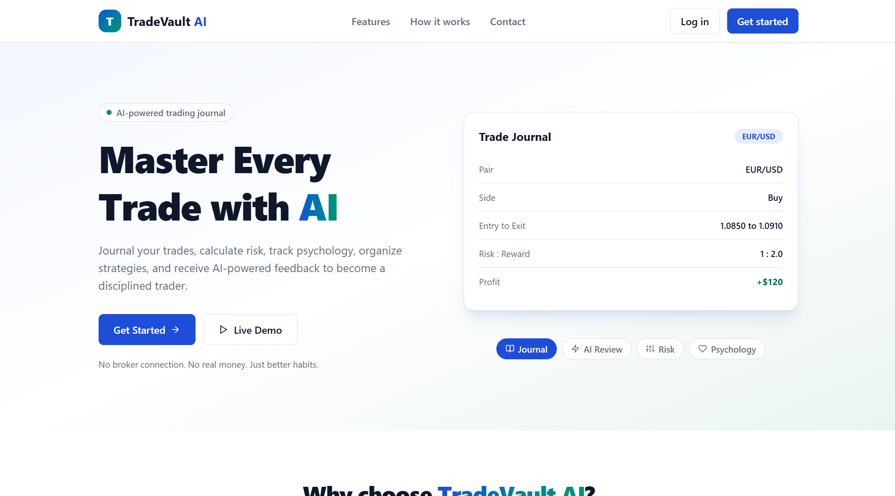
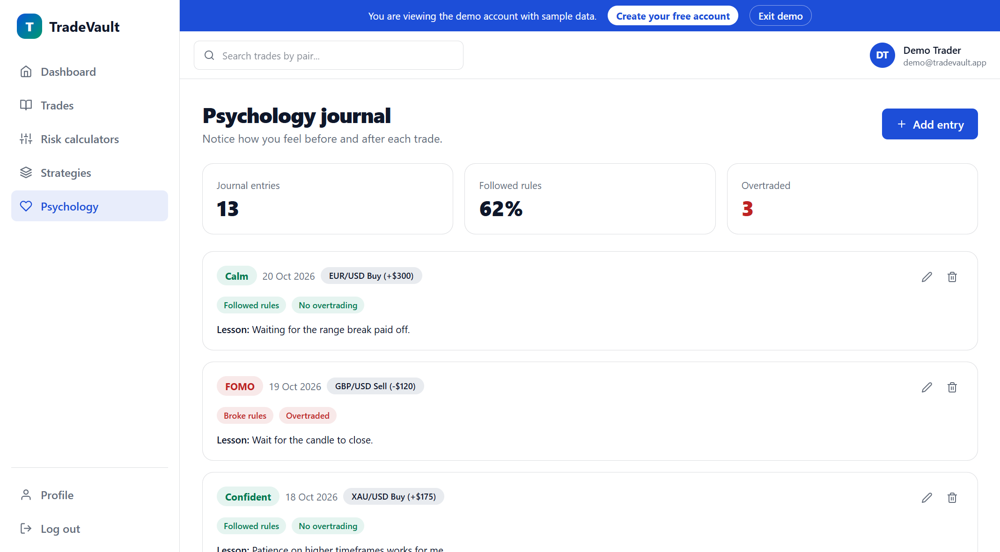

# TradeVault AI

A trading journal that helps traders become more consistent. Log trades, plan risk, track psychology, organize strategies, and get AI feedback on every trade.

> TradeVault AI is **not** a trading platform. It never connects to a broker and never places orders. Traders log trades after the fact, and the app turns that data into stats, risk calculations, and feedback.

**Live demo:** https://YOUR-APP.vercel.app (click **Live Demo**, no sign up needed)

> The backend runs on a free plan, so the first visit after a quiet period can take up to a minute to wake the server.


## Features

- **Authentication**: JWT login with hashed passwords, "remember me", protected routes, profile update, avatar, and password change
- **Trade journal**: create, edit, delete, search, filter, and sort trades, with chart screenshots stored on Cloudinary
- **Risk calculators**: position size, risk reward, and profit/loss, all calculated live in the browser
- **AI trade review**: Google Gemini returns strengths, mistakes, risk analysis, suggestions, and a discipline rating for each trade
- **Strategy library**: save rules and checklists, then attach a strategy to each trade
- **Psychology journal**: mood before a trade and questions after it, linked to the trade
- **Dashboard**: net P/L, win rate, average risk reward, and discipline score, calculated with MongoDB aggregation
- **Demo account**: one-click demo with sample data, protected from edits
- **Responsive UI**: sidebar layout that becomes a slide-in menu on mobile

## Screenshots

| Landing page | Trades with AI review |
|---|---|
|  |  |

| Risk calculators | Psychology journal |
|---|---|
|  |  |

## Tech stack

| Area | Tools |
|---|---|
| Frontend | React (Vite), Tailwind CSS v4, Framer Motion, React Router, React Hook Form, Axios |
| Backend | Node.js, Express 5, MongoDB with Mongoose |
| Auth | JWT, bcrypt |
| Uploads | Multer, Cloudinary |
| AI | Google Gemini (`@google/genai`) |
| Hosting | Vercel (frontend), Render (backend), MongoDB Atlas (database) |

## How it works

```
Add trade form  ->  POST /api/trades  ->  server calculates risk reward  ->  saved in MongoDB
Dashboard       ->  GET /api/dashboard ->  MongoDB aggregation            ->  stat cards
AI review       ->  POST /api/ai/review/:id -> prompt + Gemini (JSON)     ->  saved with the trade
```

## Design decisions

- **The server owns the calculations.** Risk reward is calculated in the backend, never trusted from the browser.
- **Every query is scoped to the logged-in user.** A user can't read, edit, or attach another user's trades or strategies, even with a valid id.
- **Structured AI output.** Gemini is asked for JSON, then every field is validated and trimmed before saving, so the UI never depends on free-form text.
- **AI cost control.** Reviews are saved with the trade, and the AI route is rate limited to 5 requests per minute.
- **Demo account safety.** The demo login has no stored password, and profile changes are blocked on it.
- **Old files are cleaned up.** Replacing or deleting a screenshot or avatar also deletes it from Cloudinary.

## Project structure

```
TradeVault/
├── backend/
│   ├── seed.js                # demo account with sample data
│   └── src/
│       ├── config/            # database, Cloudinary, Gemini
│       ├── controllers/       # request logic
│       ├── middleware/        # auth, uploads, demo protection
│       ├── models/            # User, Trade, Strategy, Psychology
│       ├── routes/            # API routes
│       ├── services/          # Cloudinary and Gemini helpers
│       └── server.js
└── frontend/
    └── src/
        ├── api/               # axios instance
        ├── components/        # landing, layout, trades, risk, ai, ...
        ├── context/           # AuthContext
        ├── layouts/           # public and dashboard layouts
        ├── pages/
        └── utils/             # formatters and risk formulas
```

## Run it locally

You need Node 20 or newer, a free [MongoDB Atlas](https://www.mongodb.com/atlas) database, a [Cloudinary](https://cloudinary.com) account, and a [Gemini API key](https://aistudio.google.com/apikey).

```bash
git clone https://github.com/YOUR-USERNAME/YOUR-REPO.git
cd YOUR-REPO
```

**Backend**

```bash
cd backend
npm install
cp .env.example .env     # then fill in the values
npm run seed             # optional: creates the demo account
npm run dev              # http://localhost:5000
```

**Frontend** (in a second terminal)

```bash
cd frontend
npm install
cp .env.example .env
npm run dev              # http://localhost:5173
```

### Environment variables (backend)

| Name | Purpose |
|---|---|
| `MONGO_URI` | MongoDB connection string |
| `JWT_SECRET` | Long random text used to sign login tokens |
| `CLIENT_URL` | Frontend address allowed by CORS (comma separated for several) |
| `CLOUDINARY_CLOUD_NAME`, `CLOUDINARY_API_KEY`, `CLOUDINARY_API_SECRET` | Image uploads |
| `GEMINI_API_KEY`, `GEMINI_MODEL` | AI trade reviews |

## API overview

All routes except `register`, `login`, and `demo` need `Authorization: Bearer <token>`.

| Method | Route | Purpose |
|---|---|---|
| POST | `/api/auth/register`, `/login`, `/demo` | Create account, log in, start the demo |
| GET | `/api/auth/me` | Current user |
| GET, POST | `/api/trades` | List (search, filter, sort) and create |
| GET, PUT, DELETE | `/api/trades/:id` | One trade |
| GET, POST | `/api/strategies` | Strategies |
| PUT, DELETE | `/api/strategies/:id` | One strategy |
| GET, POST | `/api/psychology` | Journal entries |
| PUT, DELETE | `/api/psychology/:id` | One entry |
| GET | `/api/dashboard` | Stats and recent trades |
| POST | `/api/ai/review/:tradeId` | Generate an AI review |
| PUT | `/api/users/profile`, `/password`, `/avatar` | Account settings |

## Known limitations

- Login tokens can't be revoked, so changing a password doesn't log out other devices.
- Free hosting sleeps when idle, so the first request can be slow.
- Pip value and contract size in the calculators are inputs, because they differ by broker and instrument.
- AI feedback is for learning and is not financial advice.

## Ideas for next

- Analytics charts (equity curve, best and worst pair)
- Pagination for long trade lists
- Request validation with Zod
- Weekly AI report across many trades

## Author

Built by **YOUR NAME**. [GitHub](https://github.com/YOUR-USERNAME) | [LinkedIn](https://linkedin.com/in/YOUR-USERNAME)